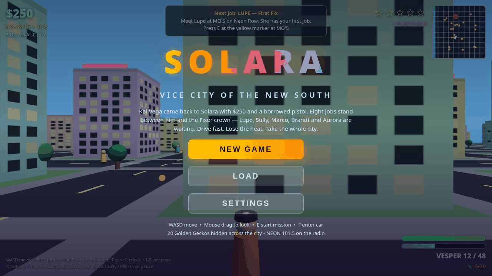

[](https://make.fun/bounty/gta6-01?utm_source=github&utm_medium=readme&utm_campaign=gta6-01)
[](https://make.fun/bounty/gta6-01/leaderboard?utm_source=github&utm_medium=readme&utm_campaign=gta6-01)
[](https://make.fun/bounty/gta6-01?utm_source=github&utm_medium=readme&utm_campaign=gta6-01)

# SOLARA — Vice City of the New South



A GTA-style open-world game built for the **gta6-01** bounty on [make.fun](https://make.fun/bounty/gta6-01).

Kai Vega came back to Solara with $250 and a borrowed pistol. Eight jobs stand
between him and the Fixer crown — Lupe, Sully, Marco, Brandt and Aurora are
waiting. Drive fast. Lose the heat. Take the whole city.

## Play

```sh
node serve.ts
# open http://localhost:8080/
```

No build step, no npm dependencies for the game itself. Three.js r187 is
vendored under `game/vendor/three/`.

## The city

- **7 districts** — Marina Bay, Old Port, Downtown, Neon Row, Palm Heights,
  Dockside and Solara Beach — each with its own colour, grip and neon.
- **Bright daytime** (~14:00, blue sky), pastel towers, turquoise ocean with
  foam, sailboats and beach umbrellas.
- **64 citizens** in bright shirts, walking the sidewalks in groups; traffic
  bumper-to-bumper on the grid; **20 Golden Geckos** hidden across the city
  (HUD counter + minimap dots).

## Jobs — 8, type-based

| # | Job | Giver | Type | Reward |
|---|-----|-------|------|--------|
| 1 | First Fix | Lupe | goto | $400 |
| 2 | Tow Job | Sully | driveTo | $650 |
| 3 | Marco's Run | Marco | driveTo | $800 |
| 4 | The Ledger | Brandt | hold 5s | $1,100 |
| 5 | Aurora's Light | Aurora | goto | $900 |
| 6 | Hot Wheels | Lupe | carjack | $1,000 |
| 7 | Heat Wave | Sully | escape | $1,400 |
| 8 | The Solara Job | Brandt | finale | $5,000 |

Ranks: ROOKIE → RUNNER (2 jobs) → HUSTLER (5) → FIXER (8).

## Systems

- **Police**: cruisers, foot officers, a detailed white helicopter whose
  searchlight beam is computed live from the lamp under its nose — apex at
  the lamp, bright pool exactly where the beam hits the ground. Roadblocks
  at 3+ stars. Lose the cops to cool the heat.
- **Crew**: Mara (GHOST, −1 star, `Z`), Sully (PIT CREW, full repair, `X`),
  Kiki (LOOKOUT, patrols revealed 20s, `C`).
- **Weapons**: VESPER pistol, JACKAL smg, LONGSHOT rifle, RIOT shotgun,
  FISTS — `1–5` to swap, `R` to reload.
- **Radio**: PUERTO 88.3, CELESTE 98.1, SOLARA 98.3, NEON 101.5 (`Q` to change).
- **F9 autopilot**, two-way dialogue with Kai replying, minimap with mission
  beacon, wanted stars, health/armour, cash and rank HUD.

## Controls

WASD move • Shift sprint • Space jump • E start mission • F enter/exit car •
R reload • 1–5 weapons • Q radio • M map • F9 autopilot • Z/X/C crew • Esc pause •
mouse drag to orbit the camera.

## Screenshots

`?shot=1` start menu • `?shot=2` packed street chase • `?shot=3` Kai meets Lupe •
`?shot=4` neon chase under the heli.

## License

MIT — see [LICENSE](LICENSE).

Referral code: `mpd7ezsn`
